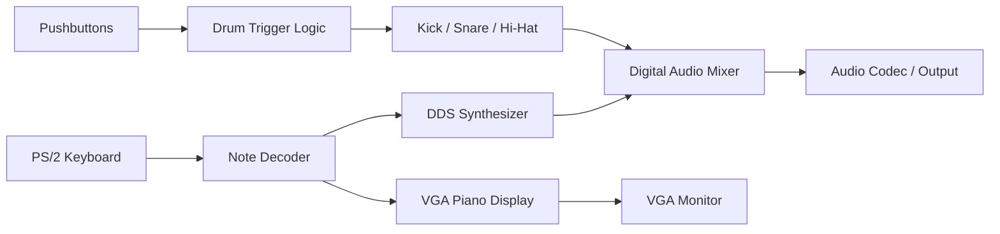

# FPGA Digital Instrument Looper

**Verilog music hardware · Terasic DE1-SoC · Intel/Altera Cyclone V SoC (5CSEMA5F31C6)**

A real-time digital instrument built on an FPGA: a 12-note synthesizer with keyboard controls, three synthesized drum voices, live audio mixing and a VGA piano visualization. The FPGA generates sound directly; it does not play back music files.

> **Working prototype:** The combined synthesizer and drum voices, physical KEY-button triggers, PS/2 controls and VGA note display were successfully demonstrated on the DE1-SoC. **Automatic 16-step sequencing and melody recording/loop playback are future work.**

## Hardware

| Component | Hardware |
| --- | --- |
| Board | Terasic **DE1-SoC** |
| FPGA chip | **Cyclone V SoC — 5CSEMA5F31C6** |
| Clock | 50 MHz (`CLOCK_50`) |
| Display | VGA via onboard port |
| Sound | Onboard audio codec → headphones or speakers |
| Development | Verilog, Quartus Prime, ModelSim |

## Features

- **Synthesizer:** 12-note DDS (phase-accumulator) synth with keyboard note decoding and waveform selection
- **Percussion:** Independently triggered kick, snare and hi-hat voices
- **Audio:** Signed digital mixing of synth and percussion, output through the onboard audio codec
- **Visualization:** 160×120 VGA piano-key indicators that highlight currently held notes
- **Verification:** Component testbenches for synth, PS/2 decoder, VGA pixel writer and drum integration

## Live controls

| Control | Action |
| --- | --- |
| PS/2 keyboard | Play synth notes |
| KEY1 / KEY2 / KEY3 | Kick / snare / hi-hat |
| KEY0 | Reset |
| SW1:SW0 | Select octave |
| SW2 | Toggle synth waveform |

## System architecture



## Repository layout

```text
rtl/
  top/                   Integrated FPGA top and synth-only reference
  audio/                 DDS synthesizer and drum mixer
    drums/               Kick, snare and hi-hat generators
  input/                 PS/2 note decoder
  video/                 VGA piano visualization and background
sim/                     ModelSim testbenches and script
constraints/             DE1-SoC pin assignments and clock constraint
docs/BUILD.md            Build/setup instructions
digital_instrument_looper.*  Quartus project settings
```

See [build and simulation instructions](docs/BUILD.md) for the peripheral dependencies and reproducible setup. External board-support IP is deliberately omitted from this repository.

## External IP used (University of Toronto)

This design uses **University of Toronto-provided peripheral interface modules** to communicate with the DE1-SoC hardware. These are supporting interfaces—not the custom synthesizer, drum synthesis, mixing, note decoding, or visual-display logic.

| Provided module | Purpose |
| --- | --- |
| `PS2_Controller` | Receives PS/2 keyboard scan codes |
| `Audio_Controller` | Transfers digital audio samples to the board's audio codec |
| `avconf` | Configures the onboard audio/video hardware over I²C |
| `vga_adapter` | Handles VGA frame-buffer output and display timing |

**These University of Toronto interface source files are not redistributed in this repository.** They must be obtained separately and added as described in [Build instructions](docs/BUILD.md). All four are explicitly instantiated by the top-level design (directly or through its board interfaces).

## Development roadmap

- 16-step programmable drum sequencer
- Melody event recording and synchronized loop playback
- Tempo adjustment and extended VGA sequencing UI

The above are planned features, not part of the current working FPGA prototype.
