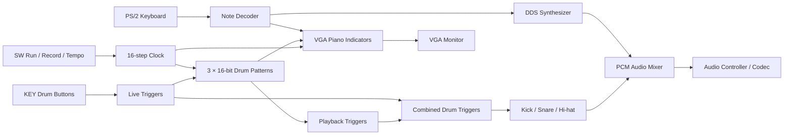

# FPGA Digital Instrument Looper

**Real-time synthesizer and programmable drum machine built in Verilog**

**Target hardware:** Terasic DE1-SoC · Intel Cyclone V SoC **5CSEMA5F31C6** · 50 MHz

A fully FPGA-based digital music instrument featuring a 12-note keyboard synthesizer, three synthesized drum voices, a **16-step rhythm sequencer**, real-time recording of drum hits, synchronized playback, audio mixing, and VGA visual feedback. Audio is synthesized in hardware rather than played from prerecorded clips.

> **Progress: Milestone 2 demonstrated on hardware.** The working prototype can record and repeat drum patterns while the PS/2 keyboard plays live synthesizer notes. The **final-project usability improvements** listed below are planned and not yet implemented.

## Features and progress

| Feature | Status |
| --- | --- |
| 12-note DDS synthesizer, square/triangle waveforms and octave selection | Working |
| PS/2 keyboard input and VGA piano-note indicators | Working |
| Kick, snare and hi-hat sound synthesis | Working |
| Live audio mixing of the synth and three drum voices | Working |
| 16-step sequencer with adjustable **60–180 BPM** tempo | **Milestone 2 — working** |
| Record three 16-step drum patterns (48 bits) | **Milestone 2 — working** |
| Automatic loop playback with live synth performance | **Milestone 2 — working** |
| VGA drum grid, current playhead and basic run/record indicators | **Milestone 2 — working** |
| Direct step editing using PS/2 keyboard and an editing cursor | **Planned for final** |
| More legible VGA interface with text labels and BPM readout | **Planned for final** |
| Preset beats and independent drum mute controls | **Planned for final** |

### Demo controls (Milestone 2)

| FPGA input | Action |
| --- | --- |
| **KEY0** | Reset and erase patterns |
| **KEY1 / KEY2 / KEY3** | Live kick / snare / hi-hat; record to current step if recording enabled |
| **SW0–SW1** | Synthesizer octave selection |
| **SW2** | Select square or triangle waveform |
| **SW3** | Start/stop drum-loop playback |
| **SW4** | Enable/disable **live** drum recording |
| **SW5** | Clear patterns on rising edge (toggle up, then down) |
| **SW6–SW9** | Tempo selector: 60 to 180 BPM in 8 BPM increments |

Recording is **timing-based and additive**: a button press stores a hit at the current step; it does not erase previously recorded hits. The loop is stored in FPGA registers, so resetting or powering off clears it.

## Hardware architecture



## Code layout

```text
rtl/
  top/
    digital_instrument_ms2_top.v   Milestone 2 hardware top
    digital_instrument_top.v       Earlier live-instrument top
    synth_only_top.v               Synth-only reference
  audio/
    synth_dds.v                    Direct digital synthesis
    drum_audio_engine_looper.v     Live + sequenced drum mixer
    drum_audio_engine.v            Earlier live-drum mixer
    drums/                          Kick / snare / hi-hat generators
  input/ps2_note_decoder.v        PS/2 note mapping
  sequencer/
    drum_step_clock.v              Sixteenth-note step clock
    drum_pattern_memory.v          Three stored 16-bit patterns
  video/
    vga_looper_display.v           Drum grid, playhead and piano
    piano_note_display.v           Earlier piano visualization
sim/                               ModelSim testbenches
constraints/                       Board pin map and 50 MHz timing
docs/                              Build guide, progress and final scope
digital_instrument_looper.qpf/.qsf Quartus project
```

## Final-project focus

Our next iteration will prioritize **making drum patterns easy to program**, not recording melodies:

1. **Interactive step editor:** Navigate steps and drum rows; toggle beats without having to time a button press.
2. **Clearer VGA interface:** Clearly differentiated edit cursor and moving playhead, drum labels, run/record state and tempo.
3. **Quick-load presets:** Common 4/4 patterns available immediately for demos.
4. **Individual drum muting and editing:** Hear/compare tracks, fix a single beat without clearing the entire pattern.

See [Final-project scope](docs/FINAL_SCOPE.md) for the implementation plan. **Melody loop recording is intentionally out of scope.**

## Building and verifying

See [build instructions](docs/BUILD.md). The Milestone 2 top module is `digital_instrument_ms2_top` and the target is **5CSEMA5F31C6**.

The prototype has been tested on a DE1-SoC. Source filenames and Quartus paths were reorganized for publication; the **repository's reorganized build has not yet been recompiled**, so it should be verified locally before relying on it as a drop-in hardware build.

## External IP acknowledgement

The design relies on **University of Toronto-provided** support modules:

| Module | Role |
| --- | --- |
| `PS2_Controller` | PS/2 keyboard scan-code transport |
| `Audio_Controller` | Send synthesized PCM samples to the audio interface |
| `avconf` | Configure the audio/video codec over I²C |
| `vga_adapter` | VGA framebuffer, timing and output |

These are external hardware-interface modules, distinct from the custom instrument logic. Their source is **not redistributed** in this repository; obtain compatible versions separately, as explained in the build guide.
