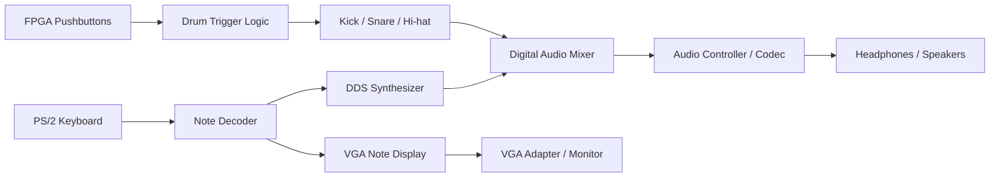

# FPGA Digital Instrument Looper

A real-time digital music instrument built in **Verilog** for the **DE1-SoC FPGA**, combining a 12-note synthesizer, synthesized percussion, audio mixing, and VGA visualization.

> **Current status:** Working hardware prototype. Synthesizer, keyboard controls, drum sounds, mixed audio output, and VGA note visualization have been tested on the DE1-SoC. The automatic sequencer and loop recording features are in development.

## Features

| Feature | Status |
| --- | --- |
| 12-note synthesizer using direct digital synthesis (DDS) | Working on FPGA |
| PS/2 keyboard note input and release detection | Working on FPGA |
| VGA visualization of active piano notes | Working on FPGA |
| Kick, snare, and hi-hat sound generation | Working on FPGA |
| Simultaneous synthesizer and percussion through a digital audio mixer | Working on FPGA |
| 16-step drum sequencing | In development |
| Melody recording and synchronized loop playback | Planned |

## Hardware demo

- **PS/2 keyboard:** Play 12 musical notes.
- **KEY1:** Kick drum.
- **KEY2:** Snare drum.
- **KEY3:** Hi-hat.
- **KEY0:** Reset.
- **VGA display:** Highlight active piano notes.

Sound generation and mixing run directly on the FPGA. The synthesizer and drum sounds can be played simultaneously.

## Architecture

### Digital logic

The synthesizer uses a **frequency lookup** and a **phase accumulator** to generate digital audio samples. Dedicated percussion modules generate kick, snare, and hi-hat signals. A digital mixer combines active sounds and feeds the board's audio codec. Keyboard scan-code decoding and a VGA pixel-writing module provide real-time control and visual feedback.

## Verification

Individual components were tested in **ModelSim**, including the synthesizer oscillator, PS/2 note decoder, VGA renderer, and kick drum. The integrated synthesizer-plus-drums design was then demonstrated on the **DE1-SoC** board.

**Tools:** Verilog HDL · Intel Quartus Prime · ModelSim · DE1-SoC FPGA · PS/2 keyboard · VGA · onboard audio codec

## Roadmap

The next phase extends the working instrument with a 16-step sequencer, step-based note memory, tempo control, and synchronized recording/playback. These features are **not yet implemented** in the working hardware demo.

## Source and media

A reviewed source-code snapshot, simulation waveforms, and demo photos/video will be added here. Board-support interfaces such as the PS/2, audio, and VGA controllers are separate from the custom modules and should retain their original attribution.
